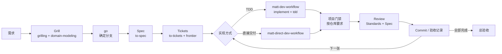
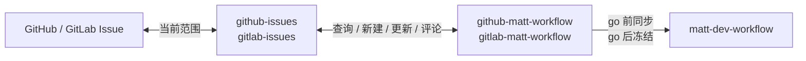

# skills

把 Matt Pocock 的原生 skill 串成开发工作流，并为 GitHub/GitLab Issue 提供适配。

## 开发流程

`matt-dev-workflow` 不复制原生 skill，而是在各阶段之间做编排，并补上无人阶段规则。`matt-direct-dev-workflow` 复用同一条前半流程，只把实现改成直接交付。

| 流程节点 | 原生 skill | 产出 |
| --- | --- | --- |
| Grill | `/grill-with-docs`（`grilling` + `domain-modeling`） | 共识、术语、ADR |
| Spec | `/to-spec` | 可验收的 spec 与 seam |
| Tickets | `/to-tickets` | tracer-bullet tickets、阻塞边、frontier |
| TDD 实现 | `/implement`（内含 `/tdd`） | 红 → 绿的代码切片 |
| Review | `/code-review` | `Standards`、`Spec` 两轴结论 |

同一时间只推进一张 frontier ticket；完成、审查和记录之后，才进入下一张。

## Issue 扩展

这两个扩展的主要目的不只是创建一个 Issue，而是在需求逐渐说清时，持续修改 Issue 正文，让它始终表达当前准确的范围：

- `*-issues` 只负责平台读写：创建、搜索、更新正文、评论；不实现需求，也不提交代码。
- `*-matt-workflow` 把 Issue 作为需求锚点：澄清期间的答案会改写正文，`go` 前同步成当前共识，`go` 后冻结，不再修改。
- 两种 workflow 都只操作当前仓库 `origin` 对应的项目，不跨仓库改 Issue。

| Skill | 用途 |
| --- | --- |
| `matt-dev-workflow` | 完整 TDD 开发流程 |
| `matt-direct-dev-workflow` | 非 TDD 的直接交付流程 |
| `github-issues` | GitHub Issue 读写 |
| `gitlab-issues` | GitLab Issue 读写 |
| `github-matt-workflow` | GitHub Issue 锚点 + TDD 开发 |
| `gitlab-matt-workflow` | GitLab Issue 锚点 + TDD 开发 |

## 使用条件

Matt workflow 需要先运行 `/setup-matt-pocock-skills`。Issue workflow 还需要当前目录有 git `origin`，并已登录对应的 `gh` 或 `glab`。目前 Issue 适配只组合 `matt-dev-workflow`，没有直接交付版本。
